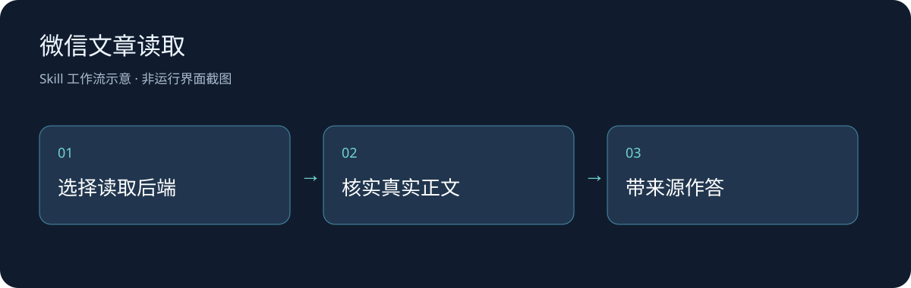

# 微信文章读取入口

本地定制的Agent工作流与MCP客户端：在拿到真实正文后再总结、翻译或分析，并识别验证码、环境异常和已删除提示。保留文章原始链接，不根据标题补写内容。



## 安装与最简演示

准备Python3.12和支持SKILL.md的宿主，将整个目录放入宿主用户技能目录，按宿主方式调用`wechat-article-reader`。独立脚本先安装：

```sh
python -m pip install -r requirements.txt
```

仓库提供一个**不访问网络、只返回原创合成文字**的MCP服务，用于复核客户端真实stdio通信。在项目根目录的PowerShell中运行：

```powershell
$env:WECHAT_READER_ROOT = (Resolve-Path examples/local-fixture).Path
python scripts/read_article.py 'https://mp.weixin.qq.com/s/synthetic-offline-fixture' --backend local --output .runtime-demo.json
```

这里的URL只是形状校验所需的合成标识，不是真实微信文章；测试服务不会打开该链接。本轮真实FastMCP4.1.0客户端与子进程通信成功，工具发现、调用与结构化响应成功，见[测试结果](examples/transport-result.json)。不据此宣称微信站点、第三方服务或真实正文提取通过。

## 读取实际文章

另行按[本地读取器官方说明](https://github.com/Bwkyd/wexin-read-mcp)安装该工具，把`WECHAT_READER_ROOT`改为其根目录。默认使用该目录的虚拟环境解释器，找不到时使用当前Python；可用`WECHAT_READER_PYTHON`显式指定。项目不捆绑上游读取器或其依赖缓存。

```sh
python scripts/read_article.py '<完整公开文章链接>' --backend local --output '<私有目录/article.json>'
```

`--backend readgzh`会把公开文章链接交给ReadGZH服务并使用共享缓存；`--backend auto`按原工作流先尝试ReadGZH再尝试本地。仅使用自己有权处理的公开文章；不希望经过第三方服务时选择local。后端可能要求认证、遇到站点限制或不可用，应按实际返回说明。

没有链接时脚本只列出所选后端工具，不表示内容读取已成功。文章、提取正文和账号配置留在独立私有目录，不提交到技能包；示例没有任何真实文章全文。

## 技术、文件与更新

Python、FastMCP客户端与Markdown工作流。`scripts/read_article.py`为实际客户端；`SKILL.md`为宿主入口；`examples/local-fixture/`为合成测试服务；`docs/`为明确标注的流程图。自有代码与文字采用[MIT](LICENSE)，FastMCP、读取器、服务和原文章保留各自许可及权利。

2026-10-26：保留原有正文校验和后端顺序，将本机固定路径改为环境配置；补充真实本地传输验证与隐私边界。尚未重新验证真实微信文章、ReadGZH服务或完整宿主总结会话；后续应在获准的实际材料上补充这些记录。
